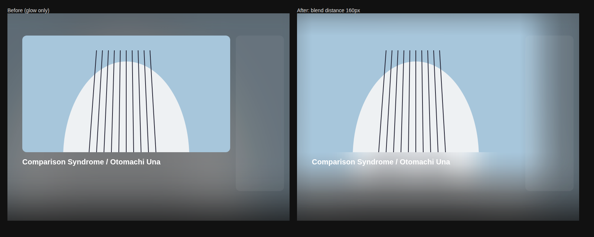
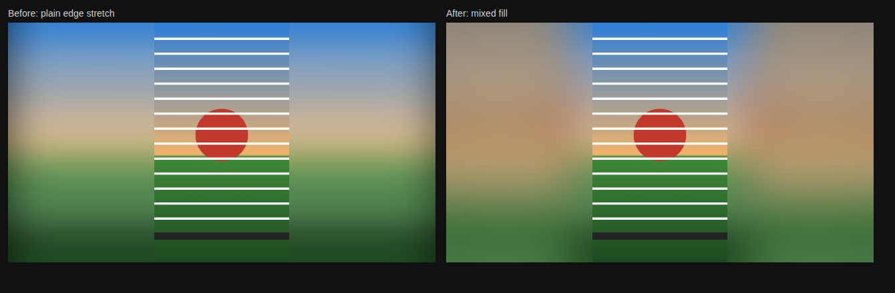

# Ambient Light for Safari (Mac)

A Safari web extension for macOS that surrounds YouTube videos with a soft glow taken from the video itself, and blends the edges of the picture into that glow so the player seems to melt into the page.

It is an independent Safari adaptation of [Ambient light for YouTube](https://github.com/WesselKroos/youtube-ambilight) by Wessel Kroos, with extra edge blending, a redesigned toolbar popup and battery-focused tuning. It runs on Safari for Mac only.



*Simulated render: the player's hard edge (left) disappears when the picture's colors are spread outward and faded into the glow (right).*

## Features

**Ambient glow.** The upstream renderer draws a blurred, video-matched glow around the player, with adjustable brightness, spread, vertical reach and softness.

**Edge blending.** A narrow, softened border blends the picture into the glow while the center of the video stays crisp. Black bars, whether encoded in the video or caused by the player's shape, are filled with the nearest picture colors.

**Mixed fill for wide bars.** When bars are wide (a vertical video in a 16:9 player, or 4:3 in fullscreen), the stretched edge fades into a zoomed, softened copy of the whole frame instead of leaving long horizontal streaks.



**Seamless regular view.** In the normal (non-theater) layout, the picture's colors spread past the player and fade into the glow, like theater mode. This layer sits behind the page content, so it never covers the title, buttons or sidebar.

**Motion controls.** Smooth motion (frame blending) on/off and strength, a glow frame-rate limit, sync video with glow, and energy saving on still videos, all in the toolbar popup.

**Battery-conscious rendering.** The edge blend renders only as finely as its blur can show, black-bar scanning slows down once the bars stop changing, and scrolling no longer re-scans the page.

**Transparent search header.** Removes YouTube's header background so the glow shows through.

## Requirements

- A Mac with a recent version of Safari.
- Xcode, only if you want a permanent install (see below).

## Installation

### Quick test (temporary extension)

1. In Safari, open **Settings → Advanced** and turn on **Show features for web developers**.
2. Choose **Develop → Add Temporary Extension…** and select the `extension` folder (the one containing `manifest.json`).
3. Open **Settings → Extensions**, enable **Ambient Light for Safari** and allow it on `youtube.com`.
4. Open a YouTube video and refresh the page.

Temporary extensions are removed when Safari quits or after 24 hours.

### Permanent install (Xcode)

Safari extensions are distributed inside a Mac app. Apple's converter creates that app project for you:

```sh
xcrun safari-web-extension-converter extension --macos-only --app-name "Ambient Light for Safari"
```

Open the generated Xcode project and choose **Product → Run**. Then enable the extension in **Safari → Settings → Extensions**. If you build without a paid developer account, also turn on **Develop → Allow Unsigned Extensions** (Safari resets this each time it quits).

When you update the code, replace the web extension resources in your Xcode project with the contents of `extension/`, then build and run again.

### Updating

After loading a new version, refresh any open YouTube tabs. Safari only adds the new code to tabs opened or refreshed after the update. Disable any other Ambient Light extension so two renderers don't run at once.

## Using it

Open a YouTube video and click the extension's toolbar icon. The glow and motion settings are grayed out until the popup connects to the YouTube tab; if it can't, the reason appears under the controls.

| Setting | Where | What it does |
| --- | --- | --- |
| Ambient light | Popup | Turns the whole effect on or off (refresh YouTube afterwards). |
| Edge blending | Popup | Width of the softened border between picture and glow. 0 turns edge blending off. |
| Blend distance | Popup | How far (0–320 px) the picture's colors spread past the player in the regular view. 0 turns it off. |
| Brightness, Spread, Vertical reach, Softness | Popup → Desktop glow | Intensity, horizontal reach, vertical reach and blur of the glow. |
| Smooth motion, strength | Popup → Motion | Blends frames for a softer glow. It trails the video slightly and runs at the full frame rate. |
| Glow frame rate | Popup → Motion | 5–60 fps, or Max to follow every video frame. Choosing a rate turns smooth motion off. Edge blending follows the same limit. |
| Sync video with glow | Popup → Motion | Makes the video wait for the glow so they never drift apart. Heavy scenes may drop a frame. |
| Save energy on still videos | Popup → Motion | Slows the glow down only when the picture is nearly still. |
| Transparent search header | Popup | Removes the header background and extra blur. |
| Everything else | Player → gear icon → Ambient light | The full upstream settings menu, including advanced options such as Spread fade start and Background greyness. |

### Tips

- **Brighter, theater-like surroundings in the regular view:** raise Brightness to about 130–150% and Blend distance to 240–320 px. In the player's Ambient light menu (Advanced on), raising Spread fade start keeps the glow strong farther out.
- **Lower battery use without losing smoothness:** set the glow Resolution to 50% (or 25%) in the player's Ambient light menu, turn on Save energy on still videos, and leave Smooth motion off. Heavy blur hides the lower resolution.
- **Glow lags behind the video:** turn off Smooth motion, set Fade in duration and Flicker reduction to 0, or turn on Sync video with glow.

## Troubleshooting

**The popup says "Not connected".** Refresh the YouTube tab (⌘R), wait for the video to play, then reopen the popup. Check that the extension is allowed on youtube.com in **Safari → Settings → Extensions → Edit Websites**. If Safari loses the normal message reply, the popup automatically falls back to talking through extension storage.

**Two glows or odd flicker.** Another Ambient Light extension is probably still enabled. Disable it and refresh.

**Native fullscreen or Picture in Picture.** These don't provide page surroundings. Use YouTube's own fullscreen button instead.

**Protected or unreadable videos.** If a frame can't be read, edge blending steps aside and the regular renderer keeps running.

## Project structure

```
ambient-light-safari/
├── extension/              # The Safari web extension (load this folder)
│   ├── manifest.json
│   ├── options.html        # Toolbar popup
│   ├── images/             # Icons and debanding noise
│   ├── scripts/
│   │   ├── content.js          # Entry point and popup bridge
│   │   ├── desktop-content.js  # Loads the upstream renderer
│   │   ├── content-main.js     # Upstream Ambient Light renderer (bundled)
│   │   ├── edge-blend.js       # Edge blending, bar fill and outer blend
│   │   ├── edge-raster.js      # Padded raster + blur
│   │   ├── canvas-blur.js      # WebGL Gaussian blur
│   │   ├── video-frame-loop.js # Frame-synced update loop with fps limit
│   │   ├── header-glass.js     # Transparent search header
│   │   ├── popup.js            # Popup logic
│   │   └── ...
│   └── styles/
├── docs/images/            # README images
├── tools/package.sh        # Builds a distributable ZIP
├── CHANGELOG.md
├── UPSTREAM.md             # Attribution details
└── LICENSE
```

### How the edge blending works

Each video frame is drawn into a small canvas that matches the player's box. Bars are filled by stretching the nearest picture pixels (or, for wide bars, by a fading stretch over a zoomed, softened copy of the frame). The result is padded by repeating its outer pixels, blurred with a separable WebGL Gaussian, and shown in two places: a narrow rim over the player's edge, and a wider, faded layer behind the page content that carries the picture's colors out into the glow. Work is bounded by blur size rather than window size, and frames are only drawn when the video shows a new frame.

## Building a ZIP

```sh
./tools/package.sh
```

This creates `dist/ambient-light-safari-<version>.zip` from the `extension` folder, which you can load with **Develop → Add Temporary Extension…**.

## Privacy

The extension asks only for storage and access to youtube.com. Settings are stored locally in Safari, and there are no remote diagnostics.

## Credits and license

Based on [Ambient light for YouTube](https://github.com/WesselKroos/youtube-ambilight) by Wessel Kroos (upstream version 2.38.17). The upstream renderer, settings menu, shaders and assets come from that project; the Safari packaging, edge blending, popup and tuning are additions. See [UPSTREAM.md](UPSTREAM.md) for details.

Released under the MIT License; see [LICENSE](LICENSE). The original copyright notice is retained.

This is an independent project. It is not an official release by the original author and is not affiliated with or endorsed by YouTube or Google. YouTube is a trademark of Google LLC.
